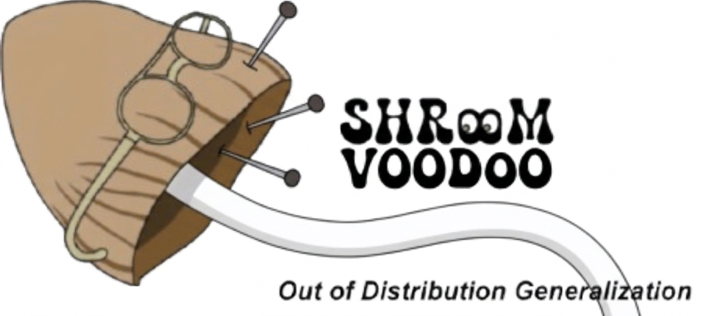



### Welcome to Shroom-voodoo: A Shared Task on Hallucination Detection in Large Vision-Language Models for Out-Of-Distribution Generalization

Welcome to the official shared task website for **SHROOM-voodoo**, a out-of-distribution evaluation of hallucination detection systems focusing on large vision-language models (LVLMs).

**Shroom-voodoo** stands for "**S**hared-task on **H**allucinations and **R**elated **O**bservable **O**vergeneration **M**istakes in **vision** language models for **O**ut-**O**f-**D**istributi**o**n Generalizati**o**n". This task invites participants to detect and classify fine-grained hallucination spans in image-conditioned text outputs, on an unseen OOD dataset designed for enduring evaluation across model generations.

This shared task builds upon the SHROOM-Visions 2026 shared task with an emphasis on a key question:

**_Can your hallucination detector generalize to entirely unseen languages and domains?_**

_The information on this website is subject to change._ 
We send announcements for any major update on the [Google group mailing list](https://groups.google.com/g/chomps-eacl2027) and the [shared task Slack](https://join.slack.com/t/shroom-shared-task/shared_invite/zt-2mmn4i8h2-HvRBdK5f4550YHydj5lpnA).
We also have socials! Find us on Twitter at [@SHROOM_ST](https://x.com/SHROOM_ST) and on BlueSky at [@shroom-st.bsky.social](https://bsky.app/profile/shroom-st.bsky.social).

#### What is Shroom-voodoo?
The task extends SHROOM-Visions, and consists of detecting and classifying spans of text corresponding to hallucinations in image-conditioned outputs. Participants are asked to:
1. Identify which character spans in a given text constitute hallucinations
2. Classify each hallucinated span into one of four categories:
   - **A. Invention**: entities, objects, properties, or events not present in the image
   - **B. Mischaracterization**: incorrect description of content that *is* visible
   - **C. OCR Problem**: misreading of text visible in the image
   - **D. Miscounting**: incorrect reporting of quantities of visible items
   - **E. Other**: the hallucination does not fit in classes A-C

In practice, each datapoint consists of:
- An image
- A textual prompt
- A text output
- Detected spans of hallucination
- A class of hallucinated content, for each span detected.

Participants must compute, for every character in the output string:
  a) The probability that it is part of a hallucinated span
  b) The hallucination category of each span 

Participants are free to use any approach they deem appropriate, including external resources, and may work on any subset of the four languages.

#### How will participants be evaluated?
Participants will be ranked along two primary (character-level) metrics:

1. **Span Identification**: Intersection-over-Union (IoU) of characters marked as hallucinated in the gold reference vs. predicted
2. **Confidence Calibration**: Correlation between the probability assigned by a participant's system that a character is hallucinated and the empirical probability observed in our multi-annotator gold data

Rankings and submissions will be handled **separately per language**. 

#### Dataset Overview
We provide a curated dataset of 20,000 samples with multiple annotations with a fine-grained, span-level labeling scheme. 

| Dataset Split | Size | Composition | Access |
|--------------|------|-------------|--------|
| **Training set** | ~15,200 samples | Outputs from 5 diverse LVLMs,  ~3,800 samples per language  |  |
| **Test set** | TBA | TBA | TBA |

Download the annotated training set and the unlabelled test set: [Download data](TBA)   
Download input images: [Download images](TBA)

We are releasing a participant kit containing:
- Scoring program and format checker
- Two baselines: a random baseline and a multimodal transformer-based system

Download the participant kit at [this link](https://a3s.fi/mickusti-2007780-pub/participant_kit.shroom_visions.zip)!

#### Important Dates
All deadlines are "anywhere on Earth" (23:59 UTC-12).

- Participation Kit Release: **29 October 2026**
- Train sets available: **1 November 2026**
- Test set release :  **Nov 26-Dec 1, 2026**
- Evaluation phase: **1-16 December 2026**
- System description papers due: **30 December 2026**
- Notification of acceptance: **18 January 2027**
- Camera-ready due: **25 January 2027** 
- UncertainLP workshop: **9-14th March 2027** (co-located with EACL 2027)

*This information is subject to change; also refer to the [CHOMPS workshop website](https://chomps-workshop.github.io/) for supplementary information.*

#### How to Participate
1. **Register**: Please register your team before making a submission on [our submission platform](https://shroom.pythonanywhere.com)
2. **Submit results**: Use our platform to submit your predictions before **16 December 2026**
3. **Submit your system description**: Papers should be submitted through [OpenReview](TBC) by **30 December 2026** (TBC)

##### System Description Paper Format
System description papers must be submitted as PDF files using the [official ACL style templates](https://github.com/acl-org/acl-style-files) and may contain up to **four pages of main content**. A required Limitations section and an optional Ethical Considerations section may follow the conclusion and do not count toward the page limit; references are unlimited. Appendices may follow the references and do not count toward the page limit, but papers must be self-contained because reviewers are not required to consider appendices. Submissions are encouraged to follow the ARR requirements for [two-way anonymized review and citation](https://aclrollingreview.org/cfp).  

Submissions will also be encouraged to cite the paper describing our dataset (a preprint of which will be made available along with the rankings) and required to cite a task overview paper in their camera-ready versions. 

Each team submitting a system description paper must nominate one paper author as a reciprocal reviewer. The nominated reviewer must agree to review at least two papers. 

*NB:* We are also open to "shared un-task" paper submissions from groups who either didn't manage to submit to the official platform on time or used the dataset for different purposes. **Reach out to organizers directly if you intend to submit such a paper.**

#### Organizers of the shared task
- [Aman Sinha](https://amansinha09.github.io/), Université de Genève, Switzerland
- [Chuyuan Li](https://chuyuanli.github.io), University Grenoble Alpes, France
- Secret CHOMPERS

#### Still have questions?
<!-- We have compiled a [**FAQ**](/shroom/2026/FAQ)! ${\color{red} BROKEN LINK}$ You can also -->
Don't hesitate to reach out via our communication channels! We're working on building up an FAQ page as well.

#### Looking for something else?
The websites for all iterations of the shared task series are available here:
- [Mu-SHROOM @ SemEval-2025 Task 3](./2025.md)
- [SHROOM-CAP @ CHOMPS workshop AACL-IJCNLP 2025 Task 6](./2025a.md)
- [SHROOM @ SemEval-2024 Task 6](./2024.md)

The logo is available in several colors: [blue](assets/img/shroom-visions-blue-vers.png), [green](assets/img/shroom-visions-green-vers.png), [brown](assets/img/shroom-visions-brown-vers.png), and [purple](assets/img/shroom-visions-purple-vers.png).
We encourage participants to use it where relevant (especially in posters and presentations)!

#### Previous Participants & Teams
*This section will be populated after the evaluation phase.*

---

**Join the mailing group**: [chomps-eacl2027@googlegroups.com](https://groups.google.com/g/chomps-eacl2027)

**[Submission platform](https://shroom-visions.pythonanywhere.com)**
